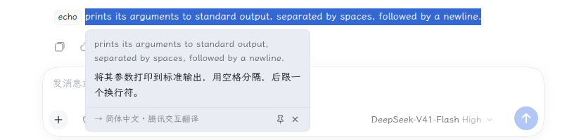
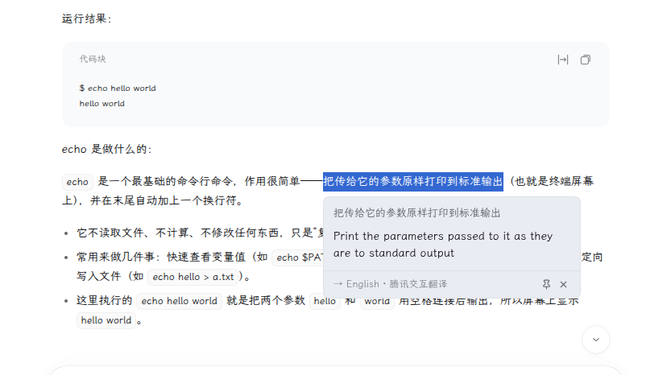
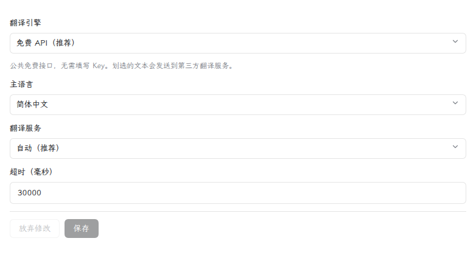

# dsh-translator

> **本仓库是 [`nicearrack/dsh-translator`](https://github.com/nicearrack/dsh-translator) 的增强 fork**，基线为上游 `v0.4.3`。
> 新增：**独立输入面板**（不用选中文本，直接输入/粘贴翻译）、**Google 翻译**（免费引擎首选）、
> **词典层**（词性分组、拼音/音标、双语例句，直接渲染在译文下方）。
> 其余与上游一致 —— 改动清单见 [CHANGELOG.md](CHANGELOG.md)，来历、核对与同步方式见 [NOTICE.md](NOTICE.md)。

基于 [DeepSeek Harness](https://github.com/deepseek-ai/deepseek-harness)（DSH）的有道风格划词翻译插件。

划选任意文本——会话消息、侧栏、输入框——选区右上角浮现悬浮**翻译**按钮，点击即弹出译文卡片。

插件提供两个引擎，可在设置里随时切换：

- **免费 API**（默认）——公共翻译接口，不需要账号、不需要 Key，装完即用。
- **大模型**——harness 自带的大模型，选中的文本不会离开你已配置的模型管道。

| [English README](README.md) | 中文 |
|---|---|

## 安装

在 DSH 的**插件**页点「添加插件」，npm 包名或 GitHub 地址都可以：

```
@tuweizhi/dsh-translator
https://github.com/TuWeiZhi/dsh-translator
```

以后要移除，在同一个页面卸载。

要更新，在同一个页面卸载后重新添加即可——npm 包名和 GitHub 地址都会取到最新版本。重启 DSH 后新版本生效。

### 从插件市场一键安装

DSH 没有官方插件市场，「发现」标签页只列**你自己添加的索引源**。本 fork 维护了一份索引，两个插件都收在里面：

1. 插件页 → 「实验性插件」→ **更多** → 启用**自定义插件市场**（DSH 自带的可选组合包，默认关闭）
2. **发现** → **索引源** → 添加
   `https://raw.githubusercontent.com/TuWeiZhi/dsh-plugins-index/main/index.json`
3. 在「发现」里选中本插件 → 安装

索引仓库：[TuWeiZhi/dsh-plugins-index](https://github.com/TuWeiZhi/dsh-plugins-index)。

## 使用

划选文本 → 点击悬浮**翻译**按钮 → 译文卡片即出。按住卡片顶部可拖动；点「固定」可锁定，避免被误关。点击译文（或原文、错误信息）即可复制。

## 功能

- 任意位置划词，悬浮按钮跟随选区，自动适配深色/浅色主题。手指或触控笔划选同样会唤起按钮；选区跨行时按钮锚定在划选结束的位置，而不是整个文本块
- 方向自动判断：选中的文字是**主语言**就译成英文，否则译成主语言。主语言支持 简体中文 / 繁體中文 / 日本語 / 한국어 / Русский
- 设置就在插件自己的页面里。选「免费 API」只显示主语言、翻译服务和超时；选「大模型」才换成模型相关选项。改动对下一次翻译立即生效，无需重启
- 卡片底部标明实际生效的一方——免费 API 显示应答的服务，大模型显示模型；命中缓存时会标注出来
- 支持复制、拖动、固定。平时只有一张卡片，但固定住的卡片会留在原地（正在翻译的也会继续译完），不会因为你接着翻译别的内容而被替换
- 同一段文本再问一次会走短期缓存，只花一次请求；「重试」刻意绕过缓存，重新去问
- 接口把原文原样退回来时，卡片会标明「未翻译」，不会把它当成译文

## 关于「免费 API」引擎

调用腾讯、微软、火山、MyMemory 的公共接口，都不需要注册、Key 或 token。请求由 DSH 的 Host 进程发出而非浏览器，因此没有 CORS 协商，也不会带上 Cookie。自动模式会依次尝试，失败接口的冷却从 30 秒起指数退避、上限五分钟；单个页面每分钟最多 60 次请求，超出后卡片会提示稍后再试。

两点需要注意：

- 这些是**厂商网页端的内部接口，不是有文档、有 SLA 的官方 API**，可能随时变更——降级链正是为此存在。全部不可用时，卡片会明确提示并指向「大模型」引擎。
- **划选的文本会离开本机**，发送到实际应答的那家服务。每个浏览器第一次用免费引擎翻译时，卡片里会说明这一点，之后不再提示。若不可接受，请使用「大模型」引擎。

## 截图

划选文本 → 选区右上角出现悬浮**翻译**按钮：


点击 → 弹出译文卡片（英译中）：



中译英方向自动判断：



设置就在插件自己的页面里：



## License

[MIT](LICENSE)
